<h1></h1>

Personal Claude Code mods, published as one marketplace. Every mod name starts with `pulse-`.

| Mod | What it does | Based on |
|---|---|---|
| [`pulse-progress`](pulse-progress) | A QueerPulse-coloured progress band above the prompt and a `/pulse` panel of subagents. It only watches. | [savvy-progress](https://github.com/JohnnyVizz/claude-kit/tree/main/plugins/savvy-progress) (MIT) |
| [`pulse-cache-tax`](pulse-cache-tax) | Keeps the one-hour prompt cache warm during `/keepwarm` windows and holds a cold send once with its estimated rewrite cost. | [karanb192/cache-tax](https://github.com/karanb192/cache-tax) (MIT) |
| [`pulse-filetree`](pulse-filetree) | An IDE-style file tree pane that shows what Claude reads and writes. | [data-goblin/claude-code-filetree](https://github.com/data-goblin/claude-code-filetree) (MIT) |
| [`pulse-reflect`](pulse-reflect) | Finds reusable corrections in short prompts and saves them to CLAUDE.md on one press. | [bayramannakov/claude-reflect](https://github.com/bayramannakov/claude-reflect) (MIT) |

Each mod has its own README with its commands, settings and everything it touches.

## Install

Add the marketplace straight from GitHub, then install the mods you want:

```bash
claude plugin marketplace add MrValraven/pulse-mods
claude plugin install pulse-progress@pulse-mods --scope user
```

To work on the mods, clone the repo and add the clone instead (`claude plugin marketplace add ./pulse-mods`). Claude Code then installs from your local files.

## Shipping a change

Sessions run a cached copy of each version, so every change to a mod needs a version bump:

1. Edit the mod and bump `version` in its `.claude-plugin/plugin.json` and in `.claude-plugin/marketplace.json`.
2. Run `node scripts/check-versions.mjs origin/main`. It fails when the two versions disagree, when a mod folder is missing from the marketplace, or when a mod changed without a bump. The same check runs on every pull request.
3. Add a line to [CHANGELOG.md](CHANGELOG.md), open a pull request and merge it.
4. Tag the release as `<mod>-v<version>`, for example `pulse-reflect-v3.3.0`.
5. Run `claude plugin update <mod>@pulse-mods`, then start a new session.

## Licence

The repository is under the [MIT licence](LICENSE). Each mod folder also keeps the licence and credits of the project it is based on.

The banner embeds [Fraunces](https://github.com/undercasetype/Fraunces) under the SIL Open Font License ([assets/LICENSE-fraunces.txt](assets/LICENSE-fraunces.txt)), and its crab is the pulse-progress sprite (see [pulse-progress/NOTICE](pulse-progress/NOTICE)). To change it, edit `scripts/make-banner.py` and run it as its header describes.
